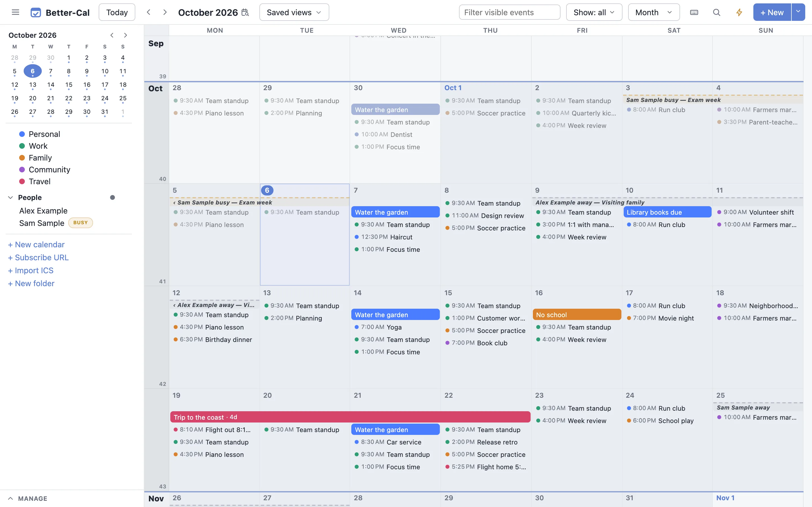
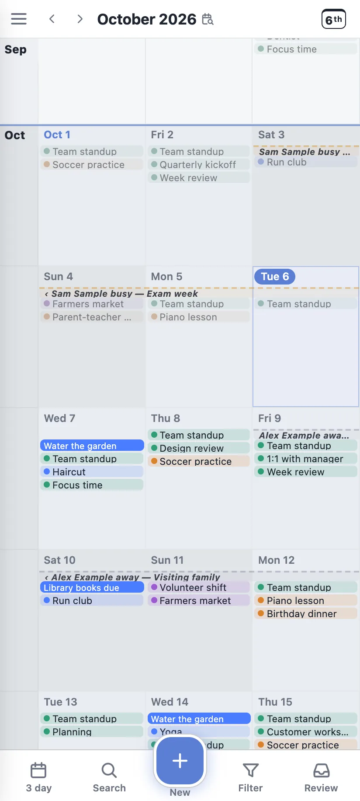
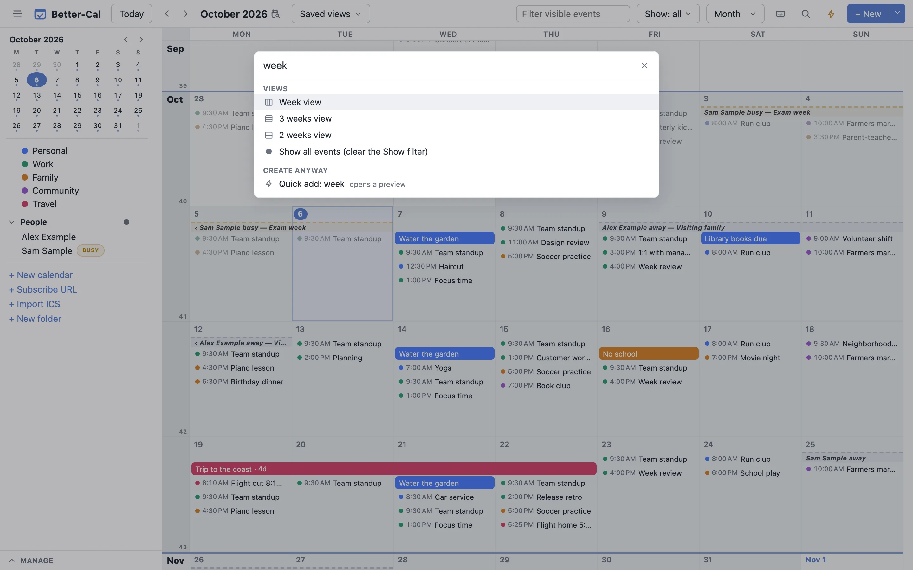

# Better-Cal

**An opinionated calendar that questions the status quo (because the status quo is a page-flipping grid from 1995).**

Built for power users, and inspired by a question: can calendars actually be made better *and* easier to use?

It covers what I used Google Calendar for day to day, and adds a lot GCal doesn't:

- **Continuous scrolling.** Months and weeks scroll instead of flipping pages.
- **Undo for any change**, from an activity log, for a week afterwards.
- **Trips and people as real objects.** Type "Sam is away next week" and it shows as a band across the calendar.
- **Saved views.** A view and its filters, back in one click.
- **Plugins.** Weather (with air quality) and sunrise and sunset come included and show right in each day's header, no API key needed. A few earlier-stage ones ship too (tides, travel time, simple planners).
- **Filters you write in plain English**, and subscribed calendars treated like an inbox instead of read-only wallpaper.
- **Built for AI agents too.** A REST API and an MCP server, with everything an agent does labeled in the activity log.

Self-hosting is table stakes: plain PHP and MySQL on the server, a no-build Preact app in the browser, and CalDAV for the calendar apps on your phone and desktop.

**[Full feature list → FEATURES.md](FEATURES.md)**

<table>
<tr>
<td align="center"></td>
<td align="center"></td>
<td align="center"></td>
</tr>
<tr>
<td align="center">Month view</td>
<td align="center">Phone</td>
<td align="center">Command palette</td>
</tr>
</table>

Click a screenshot for full size. The data is invented; `php server/bin/demo-seed.php` loads the same into a fresh install.

## What this is, and isn't

I wanted infinite scroll in a calendar. That's really the whole origin story: Google's (and almost everyone else's) month and week views have never had it, and I've always found pagination needlessly jarring and limiting. Building a calendar interface from scratch is supposed to be notoriously hard, which is why libraries like FullCalendar exist. But I'd been down that road already: building an events calendar plugin for Discourse, I tried the existing libraries, found none of them good enough, and discovered that building my own was far more doable than its reputation suggests. So I sent Claude (Fable 5) on an overnight, one-shot mission to build a calendar app from scratch, with infinite scroll as the headline feature. By morning there was a working one. Within a week it was ready to replace Google Calendar for me, and by then it did quite a few things GCal doesn't (and probably never will): undo for any change, trips and people as real objects, a relationship on every event that tells "what am I doing" apart from "what could I do" and "what's the weather", and feeds that are actually pleasant to live with.

So it's built for one person's daily use, and it runs my real calendar every day. It's single-user by design: one login, one owner, and everyone else reaches it through CalDAV, shared feeds and invitations. It's sized for one person's calendar, not a team's or a very heavy user's ([Scale and limits](docs/limits.md) has the numbers). I develop it in the open because there's no reason not to, not because it's a product: no support commitment, no roadmap promises and no compatibility guarantee between versions (though every update brings its own migrations).

What I focused on:

- **Desktop first, phones close behind.** I mostly use it on a laptop with a keyboard, so that's where the polish started: hotkeys for everything, a command palette, drag and drop that behaves. Phones have their own layout too: an installable app, a split month (dense weeks over a list that scrolls with them), an event sheet you can step through, a full-screen editor, and Back that works everywhere. I use it daily on Android.
- **Questioning defaults.** Wherever Google Calendar does something just because it always has, I asked whether it's actually good. Sometimes it is, and I kept it. Often it isn't, and that's where infinite scroll, the Show filter, context in the day header and the honest "can't be undone" on Google edits come from.
- **Other people's calendars as first-class.** Most of what's on my calendar didn't start with me, so feeds and shared calendars aren't a grudging import.
- **Honesty in the interface.** The app tells you what it did, what it can't undo, and what it's hiding.

It's had less use on iPhone than on Android, so if you have one, I'd especially like to hear how it goes. Issues and pull requests are welcome; expect honest answers about what I will and won't take on.

## Security

For a one-person project, taking security seriously means doing the work in public rather than making promises:

- **Five full scans** of the whole codebase before 1.0 (Codex Security and Claude Security). Every finding was independently verified, then fixed or, in a handful of cases, accepted with the reason recorded. Each fix commit names the finding it closes, and [SECURITY.md](SECURITY.md#what-has-been-reviewed) lists each round, what it found and what remains.
- **Latest review:** 2026-10-27, Codex Security (Daybreak Blue), of the changes in 1.1.1 to 1.3.0: 3 Low findings, fixed in the next release. [Every review](SECURITY.md#what-has-been-reviewed).
- **The fixes reviewed too**, for gaps, ways around them and anything they broke.
- **Tests** run on every change and before every deploy, including a regression test for each security fix.
- **Published advisories**, listed in [SECURITY.md](SECURITY.md#past-advisories) with the affected and fixed versions.
- **Signed releases.** Releases are signed with keys that never touch GitHub, and the updater refuses any it can't verify, so a hijacked GitHub account alone can't push code to your install.
- **Third-party code you can check.** The browser libraries are committed as their published releases, pinned by fingerprint, and `node scripts/vendor.mjs --check-upstream` confirms every one against npm ([web/vendor/README.md](web/vendor/README.md)).

[SECURITY.md](SECURITY.md) also covers the risks I accepted rather than fixed, the trade-offs made on purpose (staying signed in on your own devices, for example, and what to do if one is lost), and how to report a problem privately.

## Versions

Releases are tagged (`v1.0.0`) and listed on GitHub, and [CHANGELOG.md](CHANGELOG.md) says what changed. Settings shows the version you're running and tells you when there's a new one. Minor versions bring features; patch versions bring fixes and refinements. Each release page says what the update needs, and [Updating](docs/install.md#updating) has the steps.

## License

MIT (see [LICENSE](LICENSE)). Use it, fork it, host it, sell it. If you build something on it, a link back here is appreciated but not required. Bundled third-party software keeps its own licenses, listed in [THIRD_PARTY_NOTICES.md](THIRD_PARTY_NOTICES.md).

## Stack

- **Server:** PHP 8.4+, MySQL 8 or MariaDB 10.6+, no framework. CalDAV via sabre/dav. A cron worker polls feeds, reads mail, sends reminders, ranks events and prunes old data.
- **Web:** Preact and HTM served as-is (no build step), installable as an app. Its libraries are committed as published, listed in [web/vendor/README.md](web/vendor/README.md).
- **Optional:** an LLM provider key for plain-language help, prompt filters and ranking; a MapTiler key for map tiles; LocationIQ or MapTiler keys for faster place search ([geocoding](docs/geocoding.md)); SMTP for reminder email and RSVP replies.

## Docs

- [Installing](docs/install.md): requirements, install with SSH or from a control panel and the browser, updating (with a backup first and a way back), and Nginx and Apache setup.
- [Moving from Google Calendar](docs/migration.md): ways to start, from subscribing to try it to a full switch, and going back.
- [The app and reminders](docs/app-and-reminders.md): installing it on a phone or computer and turning on reminders.
- [Quick add](docs/quick-add.md): what you can type to make an event.
- [Calendar roles and event relationships](docs/relationships.md): planned, maybe, available and context.
- [CalDAV](docs/caldav.md), [Email ingest](docs/email-ingest.md), [Google Calendar connector](docs/google-calendar.md), [Geocoding and place search](docs/geocoding.md)
- [Scale and limits](docs/limits.md): who it's sized for, and the limits you might run into.
- [Architecture](docs/architecture.md), [private files](docs/private-files.md), [API contract](docs/api-contract.md), [agent API](docs/agent-api.md), [writing a plugin](docs/plugins/authoring.md)
- Roadmap: the [GitHub issues](https://github.com/Oshyan/better-cal/issues). There's no separate roadmap document.

## Configuration

The installer (or the setup page, without SSH) writes the settings file, `.env.php`. [`.env.example`](.env.example) lists every setting the server reads and what each is for; to change one, edit `.env.php` and keep its first line. Change your password in Settings, Account, or reset it from the command line with `php server/bin/seed.php --email=you@example.com`, which signs out every browser (add `--revoke-tokens` after a suspected compromise; [If a device is lost or stolen](SECURITY.md#if-a-device-is-lost-or-stolen) has the details).

## Development

- **Tests and contributing:** [CONTRIBUTING.md](CONTRIBUTING.md) has every test suite and when to run it.
- **Deploying:** `./scripts/deploy.sh` is the maintainer's deploy tool ([deploying.md](docs/deploying.md)); you don't need it to install or update.
- **Chrome extension** (sends Google Calendar "add to calendar" links here instead): [`extension/`](extension/).
