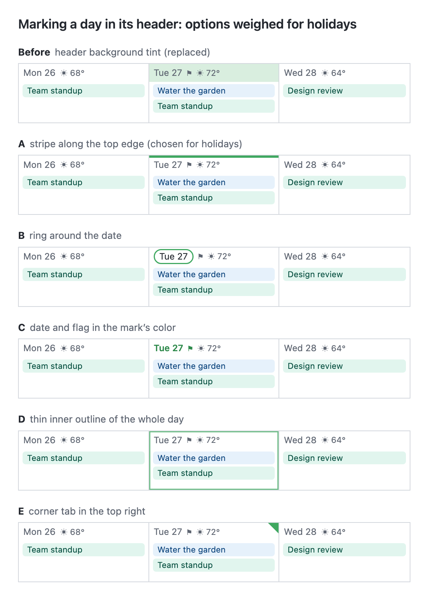

# Marking a Day

Ways to make one day stand out in its header, weighed when holidays needed a mark (2026-10-27). Kept for the next time a day needs one: a selected day ([#168](https://github.com/Oshyan/better-cal/issues/168)), a filter's "highlight the day" ([#72](https://github.com/Oshyan/better-cal/issues/72)), or anything else.

The mockup is [day-marks.html](day-marks.html) (open it in a browser to change it). The data is invented.

## What Each Mark Means Now

So a new mark doesn't collide with an existing one:

- **Today:** the date in a filled accent pill.
- **A holiday:** a 3-pixel stripe along the top of the day's header, in the holiday calendar's color (option A), plus a flag where the name doesn't fit.
- **A month's first day:** its date in the accent color; in the week views, a 2-pixel rule down the left edge of the column.
- **A weekend:** a faint background tint.
- **A drop target while dragging:** an accent background across the whole day.

## The Options

| Option | Verdict | Notes |
|---|---|---|
| Before: background tint across the header | Replaced | It works, but it looks bad behind colored elements, gray text and the thin gray borders. |
| A: stripe along the top edge | Chosen for holidays | Never sits behind text or chips. Reads at a glance on a phone and works the same on month, week and day headers. |
| B: ring around the date | Liked | Clashes with today's filled pill: a holiday that's also today would show both. Workable by swapping them: today becomes an outlined pill and a filled pill means something else (a holiday, say). An outline alone reads subtly on a phone. |
| C: date and flag in the mark's color | Not chosen | The quietest, but colored text is easy to miss, and in dark mode it competes with the weather token. |
| D: thin outline of the whole day | Not chosen | Reads as a selection or a drop highlight more than as information about the day. |
| E: corner tab in the top right | Liked | Sits where the hover "+" appears on a computer. Workable if the tab hides, or the "+" sits over it, on hover. |

So the ones worth reaching for next are B (with today redrawn as an outline) and E (with the hover handling above), then C as a quiet extra beside another mark.
